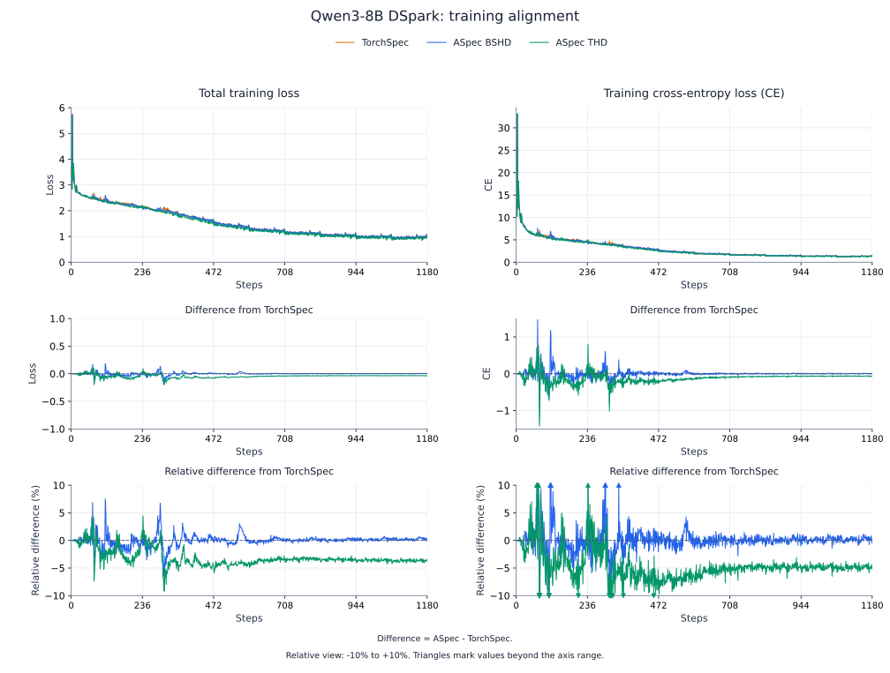
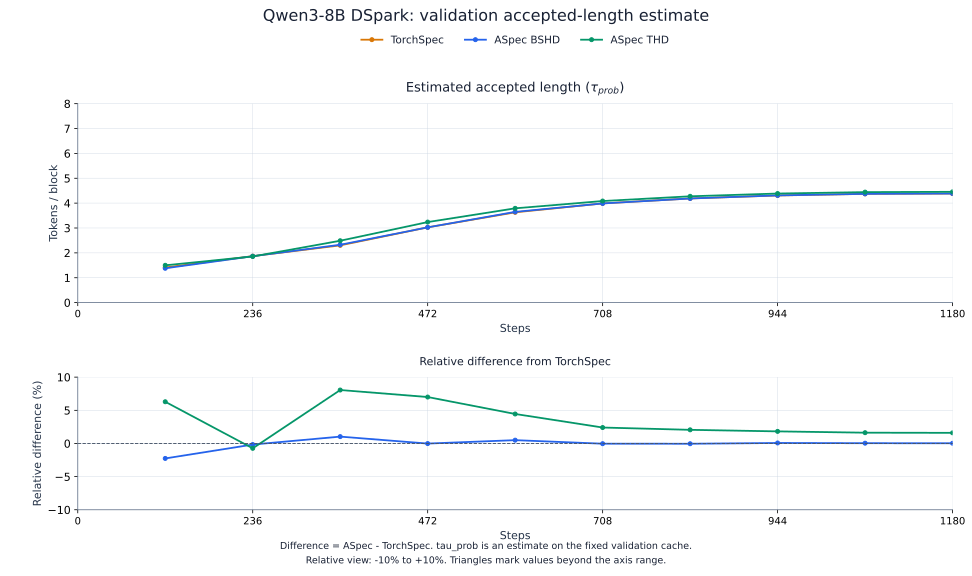
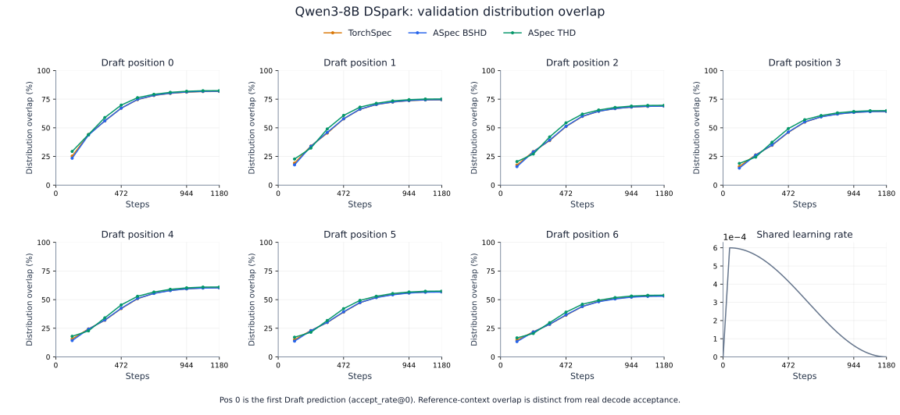

# DSpark training and acceptance comparison

This report compares TorchSpec with ASpec's unpacked (BSHD) and packed (THD) training
on Qwen3-8B DSpark. The three runs fix each optimizer step's documents,
per-document anchors, initial weights and learning-rate schedule. Training total loss
and CE are the primary alignment measurements; validation supplies acceptance estimates
and checkpoint selection, and real decoding measures the final accepted length.

See the separate [context-parallel quality report](dspark-cp-alignment.md) for CP-degree
comparisons, and [benchmark results](results.md) for training throughput.

## Shared settings

| Item | Setting |
| --- | --- |
| Target / Draft | Qwen3-8B / five-layer GQA DSpark; frozen embedding and Target head |
| Corpus | 60,416 Target-generated documents; 44,174,395 input tokens per epoch |
| Training | Ten epochs; 1,180 updates; GBS512 **documents**; DP4, replicated Drafts; CP=1 |
| Anchors | At most 512 per document; identical positions, keep masks and labels across all three |
| BSHD | One variable-length document per microbatch; 128 microbatches per rank/update |
| THD | Whole documents naturally packed into rows of at most 4K tokens, within the same update and rank |
| Precision / optimizer | Native BF16 models/gradients, FP32 masters and AdamW; weight decay 0; clip norm 1 |
| Schedule | Peak LR 6e-4; 47-update warmup; cosine decay over the same 1,180-update horizon to zero |
| Validation / selection | Same 760 documents and Target features; evaluate/save every 118 updates; minimum pooled CE |
| Decode evaluation | Same 256 held-out questions; three greedy repeats; at most 256 new tokens |

All three runs use four Draft GPUs and four TP1 Target GPUs. ASpec THD packs
whole documents within each logical rank's optimizer window; BSHD executes one document
per microbatch. The document and per-document anchor budgets are unchanged by packing.

The held-out split uses stable hashes of saved prompt IDs, with no train/validation/acceptance
question overlap. Validation scores cover 760 documents after dropping the three-document
DP4 tail. All three use the same saved responses, tokenization and conversation boundaries.

ASpec retains cuDNN attention, fused Q/K preparation, Quack RMSNorm, tiled L1 and Hopper fused
clipping. TorchSpec uses native FlexAttention, gradient normalization and AdamW,
with separate FP32 clipping at the same norm limit. The training objective and precision
settings match across all three.
ASpec BSHD uses `645a215` with acceptance observations; THD uses
`f9d5d06`. TorchSpec is frozen at
`a4e5c1085bfc5990ddcae6cf5832bb26380b38d3`.
The recorded environment is Hopper (H200), Python 3.12, PyTorch 2.13.0+cu130, SGLang 0.5.21,
FA4 4.0.0b34, CUTLASS DSL 4.7.1, Quack 0.6.5, Triton 3.7.1, cuDNN 9.20.0.48
and cuDNN Frontend 1.31.0.

## Fixed training sequence

A corpus and random seed alone do not fix an asynchronous training sequence. This comparison
fixes the original documents assigned to every update and rank, along with their input tokens,
supervision masks and per-document anchor positions. All three use the same frozen Target and
feature-generation runtime; validation uses a shared Target-feature cache.

Each update contains **512 original documents** across four logical Draft replicas. Each epoch contains
60,416 documents, giving **604,160 document occurrences over ten epochs**. Valid anchor and
supervised-position counts match at every update. THD packs whole documents within each
rank's update, preserving document-local positions and attention boundaries. It sees the same
documents and anchors as BSHD; packing does not expand the training budget.

## Training results

**Total loss** is the complete DSpark training objective:
`0.1 × CE + 0.9 × L1 + confidence BCE`. CE measures prediction of the reference tokens;
L1 measures the distance between Draft and Target probability distributions; confidence BCE
trains the confidence head against analytical acceptance probabilities. The table reports
these losses on validation data, using the same position weighting and supervision normalization
as training. Lower is better for all four loss rows. **CE is only one component of total loss**;
the progress bar and `avg_loss` monitor CE. Checkpoints here are selected by validation CE.

These terms follow [DSpark §3.3, Eqs. 9–12](https://arxiv.org/html/2607.05147v1#S3.SS3).
The paper calls its distribution-matching term `L_tv`, but Eq. 10 uses the raw L1 distance;
the factor `1/2` belongs to the acceptance-probability formula, not this loss term.

### Training-batch alignment

Training is the primary alignment view: every framework receives the same documents,
anchors and supervision at each optimizer step. The plots compare **training total loss
and CE** over all 1,180 steps without smoothing. The batch changes between steps;
the comparison at each step uses the same batch across frameworks.

Each column shows measured values, the signed difference from TorchSpec, and the
relative difference `100 × (ASpec − TorchSpec) / TorchSpec`, plotted against **Steps**.
Relative panels use a **−10% to +10%** view; boundary triangles mark values beyond
the view. The Steps axes begin at zero, with the first measured training step at 1.



### Fixed validation: checkpoint selection and acceptance estimates

The fixed 760-document validation cache measures the changing model on unchanged inputs.
It provides **estimated accepted length (τ_prob)** and per-position probability-distribution
overlap; validation CE remains the checkpoint-selection criterion rather than a separate
alignment plot. Real accepted length is measured later through actual speculative decoding.

Validation CE is the token-prediction loss on held-out documents; lower is better.
It is used to select checkpoints. All three runs independently select step 1,180 by minimum
validation CE.

| Final 760-document validation | TorchSpec | ASpec BSHD | ASpec THD |
| --- | ---: | ---: | ---: |
| Total loss | 1.082102 | 1.080127 | 1.062708 |
| Cross-entropy loss (CE) | 1.560284 | 1.555042 | 1.515060 |
| Distribution-matching loss (L1) | 0.595802 | 0.595357 | 0.581307 |
| Confidence loss (BCE) | 0.389851 | 0.388801 | 0.388025 |
| Estimated accepted length (τ_prob, includes Target) | 4.384606 | 4.386140 | 4.454830 |

Estimated accepted length is a training/validation probability-based proxy; higher is better.
It is distinct from the measured decode length below.



The acceptance-estimate figure uses the same **−10% to +10%** relative view.
Its first validation point is step 118, while the Steps axis starts at zero.

<details>
<summary>Detailed validation CE and checkpoint values</summary>

Relative to TorchSpec, BSHD CE is **0.005242 lower (0.3360%)**, and THD
CE is **0.045224 lower (2.8984%)**. Total loss and estimated accepted length need not
rank checkpoints in the same order as CE, which is the selection criterion.

| Steps | TorchSpec CE | ASpec BSHD CE | ASpec THD CE |
| --- | ---: | ---: | ---: |
| 118 | 5.473558 | 5.540723 | 5.215339 |
| 236 | 4.383007 | 4.306183 | 4.352905 |
| 354 | 3.703431 | 3.556242 | 3.351539 |
| 472 | 2.685461 | 2.682733 | 2.504128 |
| 590 | 2.101336 | 2.098441 | 1.985110 |
| 708 | 1.824470 | 1.816879 | 1.739128 |
| 826 | 1.678841 | 1.672762 | 1.611991 |
| 944 | 1.595656 | 1.592268 | 1.547252 |
| 1,062 | 1.563570 | 1.560055 | 1.519197 |
| 1,180 | 1.560284 | 1.555042 | 1.515060 |

| Steps | TorchSpec estimated length | ASpec BSHD estimated length | ASpec THD estimated length |
| --- | ---: | ---: | ---: |
| 118 | 1.411077 | 1.379237 | 1.499839 |
| 236 | 1.868556 | 1.865504 | 1.854864 |
| 354 | 2.301626 | 2.325389 | 2.487125 |
| 472 | 3.026332 | 3.025879 | 3.238236 |
| 590 | 3.629861 | 3.647967 | 3.791228 |
| 708 | 3.988860 | 3.987474 | 4.084696 |
| 826 | 4.188422 | 4.186618 | 4.274570 |
| 944 | 4.307234 | 4.310448 | 4.385731 |
| 1,062 | 4.371670 | 4.373478 | 4.442703 |
| 1,180 | 4.384606 | 4.386140 | 4.454830 |

BSHD starts with slightly higher CE at step 118 and stays close to TorchSpec
later in training. THD has lower CE at all ten validation points in this run.

</details>

### Per-position validation overlap

For each prediction position, **distribution overlap** compares the full Draft and Target
token distributions on the reference context:
`alpha = sum_v min(p_draft(v), p_target(v)) = 1 - L1(p_draft, p_target) / 2`.
DSpark calls this the **analytical acceptance rate** (Eq. 8). It ranges from 0% to 100%;
higher means closer distributions. For example, 81.7647% below is the mean overlap at the
first prediction position. It measures distribution similarity on reference contexts; actual
decode acceptance is reported separately below.

| Draft prediction position (0-based) | TorchSpec | ASpec BSHD | ASpec THD |
| --- | ---: | ---: | ---: |
| 0 | 81.7647% | 81.9176% | 82.4633% |
| 1 | 74.4270% | 74.5298% | 75.2102% |
| 2 | 68.8769% | 68.9149% | 69.6558% |
| 3 | 64.2896% | 64.2501% | 65.0376% |
| 4 | 60.3548% | 60.2380% | 61.0506% |
| 5 | 56.8064% | 56.6129% | 57.4434% |
| 6 | 53.2810% | 53.0302% | 53.8831% |



Positions use **zero-based numbering (0–6)** throughout this report: **pos 0** is the
first Draft prediction and matches `accept_rate@0` (position 1 in the paper).
BSHD does not lead TorchSpec at every position. Estimated accepted length is pooled from per-block
prefix products and cannot be reconstructed by multiplying this table's marginal rates.

## Real verifier acceptance on the same sequence

**Mean accepted length (τ)** is the measured number of output tokens emitted per verification
round: `total completion tokens / total verifier calls`, including the Target-generated bonus
token. Its unit is **tokens/round**. For example, τ = 3.746300 means that a verification
round emits 3.746300 output tokens on average. It measures actual decoding; the estimated length and
distribution-overlap curves above are computed on reference contexts during training/validation.

This definition agrees with the [vLLM acceptance-metric definition](https://docs.vllm.ai/en/latest/features/speculative_decoding/acceptance_metrics/), which includes the bonus token.
The name and inclusion of the Target token follow
[DSpark §4.1](https://arxiv.org/html/2607.05147v1#S4.SS1). The paper evaluates sampling at
temperature 1; this study uses greedy decoding, so its absolute values are not directly comparable
with the paper's tables. DSpark Figure 2 reports **position-wise conditional acceptance** during
real decoding: accepted tokens at position `j` divided by attempts whose earlier Draft positions
were all accepted. That is a measured acceptance rate; this study's per-position table instead
reports analytical distribution overlap, and does not measure that rollout statistic.

Each selected export uses the same official SGLang 0.5.21 DSPARK decoder: FA3, TP1,
greedy/non-thinking, gamma 7 and verification budget 8. Evaluation enables official
deterministic inference and normal radix cache.

All 256 questions × three repeats complete. Greedy output token IDs match Target-only
decoding across all three exports and all repeats.

| Actual verifier measurement, all three repeats | TorchSpec | ASpec BSHD | ASpec THD |
| --- | ---: | ---: | ---: |
| Completion tokens | 181,497 | 181,497 | 181,497 |
| Actual verifier calls | 49,512 | 49,164 | 48,447 |
| Mean accepted length (τ, tokens/round; includes bonus token) | 3.665717 | 3.691665 | 3.746300 |

Relative changes below use `100 × (τ / τ_reference − 1)`. The main measurements above
remain in tokens per verification round; the percentage table describes their relative change.

| Paired decode comparison | Mean accepted length change | 95% paired interval for the change |
| --- | ---: | ---: |
| BSHD vs TorchSpec | +0.7078% | [+0.0690%, +1.3439%] |
| THD vs TorchSpec | +2.1983% | [+1.4316%, +2.9745%] |

Bootstrap uses 10,000 resamples, seed 42, with repeats pooled within each of the 256 questions.
It measures question variability for these trained checkpoints, not variability across training
seeds.

## Computation and quality

The comparison keeps the same training task, initialization, optimizer and learning-rate
schedule while allowing each framework to use its native execution path. Different tensor
shapes and floating-point accumulation orders can produce different gradients and training
trajectories. Matching the training inputs does not require bitwise-identical weights.

THD's better result is observed under an equal document and anchor budget.
This study does not establish that packing consistently improves quality. Results cover
one training sequence and initialization on Qwen3-8B; other seeds and models require
separate evaluation. The [CP quality report](dspark-cp-alignment.md) contains the
context-parallel comparisons and their numerical controls.

## Training acceptance observations

DSpark reports per-position **analytical acceptance rate (distribution overlap)**
as `accept_rate@0`, `accept_rate@1`, etc., and **estimated accepted length** as
`tau_probabilistic` during training and validation.
For each block, form `alpha = 1 - L1 / 2`, apply its contiguous
supervision mask, then compute `tau_prob = 1 + sum(cumprod(alpha))`. Pool position
numerators/counts and block tau sums/counts before division. Tau includes one
Target token. This is a reference-context estimate, not a measurement or a guarantee of the
greedy decoder's accepted length. See [evaluation](../user-guide/evaluation.md) for
the metric keys and their distinction from hard-label accuracy.

## Reproduction

Use the [training recipes](../user-guide/recipes.md) for normal training. A controlled comparison
must additionally preserve every update's document/rank assignments, per-document anchor arrays,
initial checkpoint, optimizer and LR schedule. A shared corpus and seed alone are insufficient.
See [contributor validation](../contributing/validation.md) for runtime and numerical checks.

Export each independently selected checkpoint with `tools.convert_to_hf`, then evaluate its own
asset against the same held-out prompts:

```bash
python -m tools.evaluate_draft --target "$TARGET" --draft "$OWN_EXPORT" \
  --data "$ACCEPTANCE_DATA" --output "$OWN_DECODE_JSON" \
  --samples 256 --max-new-tokens 256 --repeats 3 --disable-thinking --deterministic-inference
```

Pool completion-token and verifier counts across all questions and repeats before computing
mean accepted length. The evaluator checks greedy output equality and reports failures via
its verdict and exit status.
