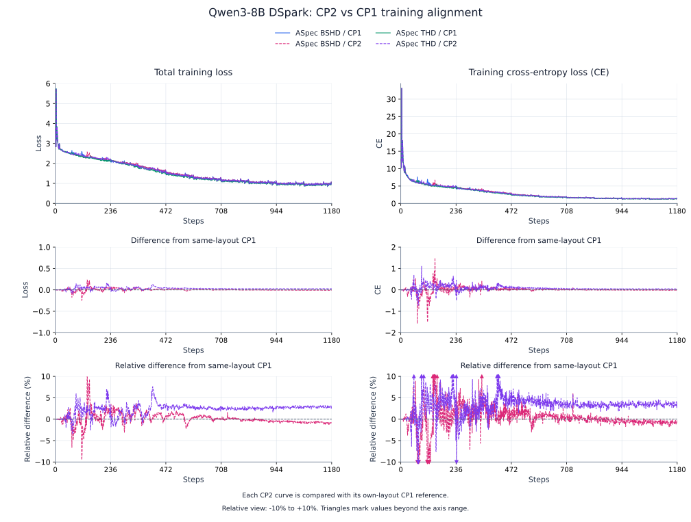
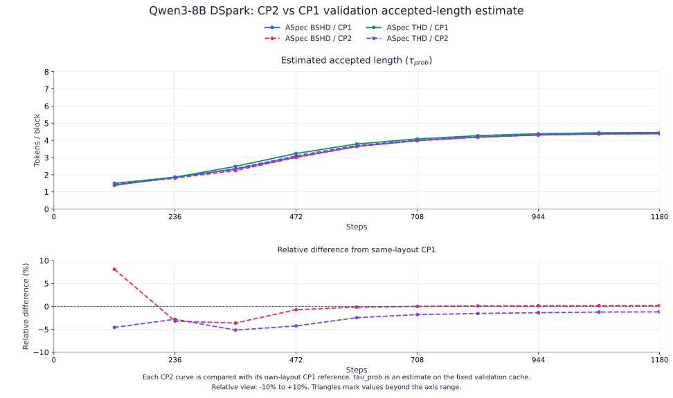
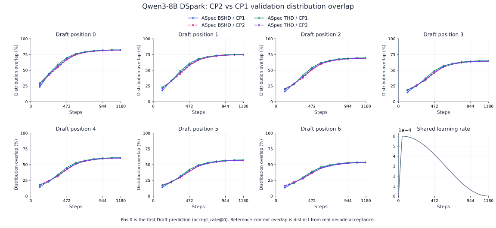

# DSpark context-parallel quality alignment

This report compares **CP2 with CP1 within each ASpec layout**, BSHD and THD, on
Qwen3-8B DSpark. Its references are BSHD / CP1 for BSHD / CP2 and THD / CP1 for
THD / CP2. The [framework report](dspark-alignment.md) separately compares
TorchSpec with ASpec BSHD and THD.

Training loss and CE are the primary alignment views. Fixed validation provides
estimated acceptance and checkpoint selection; real decoding measures final accepted
length. This is a quality comparison, with no claim about CP throughput.

## Matched conditions

| Item | Setting |
| --- | --- |
| Target / Draft | Qwen3-8B / five-layer GQA DSpark; frozen embedding and Target head |
| Training budget | 60,416 documents × ten epochs = 604,160 document occurrences; 1,180 optimizer steps |
| Logical batch | GBS512 documents; DP4; 128 documents per logical DP replica per step |
| Anchors | At most 512 per document; fixed positions, keep masks and labels |
| CP1 placement | Four Draft GPUs and four TP1 Target GPUs |
| CP2 placement | Eight Draft GPUs (DP4 × CP2), with four TP1 Target GPUs on a separate node |
| BSHD | One document per microbatch; no packing |
| THD | Same whole-document groups naturally packed to 4K within each rank's optimizer window |
| Precision / optimizer | Native BF16 models/gradients; FP32 masters and AdamW; REPLICATE; weight decay 0; clip norm 1 |
| Schedule | Same initialization; peak LR 6e-4; 47-step warmup; cosine to zero at step 1,180 |
| Validation | Same 760-document Target-feature cache; evaluate/save every 118 steps; select minimum pooled CE |
| Real decode | Same 256 questions × three greedy repeats; at most 256 new tokens; non-thinking |

CP divides each document's anchor budget across its CP ranks; it does not multiply the
training budget. Every logical DP replica retains its original documents and supervision.
The THD runs retain the same packed rows. They use the fixed optimizer-window observation
adapter to preserve this work; this is not an online packed-scheduler throughput or recovery test.

The recorded environment is Hopper H200, Python 3.12, PyTorch 2.13.0+cu130, SGLang 0.5.21,
FA4 4.0.0b34, CUTLASS DSL 4.7.1, Quack 0.6.5, Triton 3.7.1, cuDNN 9.20.0.48 and
cuDNN Frontend 1.31.0. ASpec BSHD / CP1 uses `645a215` with acceptance observations;
THD / CP1 and both CP2 runs use `f9d5d06`. Training uses the native cuDNN execution path.

## Training alignment

The figures are plotted by **Steps**. Each comparison uses `CP2 − CP1` and relative
difference `100 × (CP2 − CP1) / CP1` for the matching layout. Relative panels show
**−10% to +10%**; boundary triangles indicate values beyond the view. The first
training observation is step 1, with the Steps axis starting at zero.

The objective is `0.1 × CE + 0.9 × L1 + confidence BCE`, matching the CP1 report.
Inputs and anchors match at each optimizer step; documents vary between steps.

## Validation and checkpoint selection

All four runs independently select step 1,180 by minimum validation CE. Validation CE
is the held-out token-prediction loss; it selects the checkpoint, rather than replacing
the training alignment or acceptance measurements.

| Final 760-document validation | ASpec BSHD / CP1 | ASpec BSHD / CP2 | ASpec THD / CP1 | ASpec THD / CP2 |
| --- | ---: | ---: | ---: | ---: |
| Total loss | 1.080127 | 1.079737 | 1.062708 | 1.077072 |
| Cross-entropy loss (CE) | 1.555042 | 1.556483 | 1.515060 | 1.544423 |
| Distribution-matching loss (L1) | 0.595357 | 0.594305 | 0.581307 | 0.591673 |
| Confidence loss (BCE) | 0.388801 | 0.389214 | 0.388025 | 0.390124 |
| Estimated accepted length (τ_prob, includes Target) | 4.386140 | 4.395004 | 4.454830 | 4.401569 |

BSHD / CP2 finishes with **0.0926% higher CE** than BSHD / CP1. THD / CP2 finishes
with **1.9381% higher CE** than THD / CP1 in these runs.

Estimated accepted length (τ_prob) is computed on reference contexts and includes one
Target token. It differs from the real accepted length reported below. See the
[metric definitions](dspark-alignment.md#training-acceptance-observations).

Detailed validation checkpoint values

| Steps | ASpec BSHD / CP1 CE | ASpec BSHD / CP2 CE | ASpec THD / CP1 CE | ASpec THD / CP2 CE |
| --- | ---: | ---: | ---: | ---: |
| 118 | 5.540723 | 5.182935 | 5.215339 | 5.520660 |
| 236 | 4.306183 | 4.566555 | 4.352905 | 4.808718 |
| 354 | 3.556242 | 3.648209 | 3.351539 | 3.543585 |
| 472 | 2.682733 | 2.706775 | 2.504128 | 2.612509 |
| 590 | 2.098441 | 2.119074 | 1.985110 | 2.046547 |
| 708 | 1.816879 | 1.825835 | 1.739128 | 1.796475 |
| 826 | 1.672762 | 1.678589 | 1.611991 | 1.655169 |
| 944 | 1.592268 | 1.597457 | 1.547252 | 1.579929 |
| 1,062 | 1.560055 | 1.560236 | 1.519197 | 1.547896 |
| 1,180 | 1.555042 | 1.556483 | 1.515060 | 1.544423 |

| Steps | ASpec BSHD / CP1 estimated length | ASpec BSHD / CP2 estimated length | ASpec THD / CP1 estimated length | ASpec THD / CP2 estimated length |
| --- | ---: | ---: | ---: | ---: |
| 118 | 1.379237 | 1.491040 | 1.499839 | 1.431245 |
| 236 | 1.865504 | 1.805703 | 1.854864 | 1.802800 |
| 354 | 2.325389 | 2.240923 | 2.487125 | 2.358638 |
| 472 | 3.025879 | 3.004453 | 3.238236 | 3.100310 |
| 590 | 3.647967 | 3.642353 | 3.791228 | 3.698176 |
| 708 | 3.987474 | 3.988075 | 4.084696 | 4.011764 |
| 826 | 4.186618 | 4.191188 | 4.274570 | 4.208640 |
| 944 | 4.310448 | 4.316763 | 4.385731 | 4.325820 |
| 1,062 | 4.373478 | 4.381155 | 4.442703 | 4.387911 |
| 1,180 | 4.386140 | 4.395004 | 4.454830 | 4.401569 |

## Per-position validation overlap

Positions are numbered **0–6**; pos 0 is the first Draft prediction (`accept_rate@0`).
Distribution overlap is `1 − L1 / 2`, evaluated on the reference context, rather than
conditional acceptance measured during speculative decoding.

| Draft prediction position (0-based) | ASpec BSHD / CP1 | ASpec BSHD / CP2 | ASpec THD / CP1 | ASpec THD / CP2 |
| --- | ---: | ---: | ---: | ---: |
| 0 | 81.9176% | 81.8656% | 82.4633% | 81.9630% |
| 1 | 74.5298% | 74.5266% | 75.2102% | 74.6659% |
| 2 | 68.9149% | 68.9864% | 69.6558% | 69.1057% |
| 3 | 64.2501% | 64.3603% | 65.0376% | 64.4879% |
| 4 | 60.2380% | 60.3820% | 61.0506% | 60.5583% |
| 5 | 56.6129% | 56.8077% | 57.4434% | 56.9460% |
| 6 | 53.0302% | 53.2404% | 53.8831% | 53.4582% |

## Real speculative decoding

Mean accepted length **τ** is `total completion tokens / actual verifier calls`, in
**tokens/round**, including the Target-generated bonus token. All runs use official
SGLang 0.5.21, FA3, TP1, deterministic inference, normal radix cache, greedy/non-thinking
decoding, DSPARK gamma 7 and verification budget 8. Output token IDs match Target-only
decoding across all questions and repeats.

| Actual verifier measurement, all three repeats | ASpec BSHD / CP1 | ASpec BSHD / CP2 | ASpec THD / CP1 | ASpec THD / CP2 |
| --- | ---: | ---: | ---: | ---: |
| Completion tokens | 181,497 | 181,497 | 181,497 | 181,497 |
| Actual verifier calls | 49,164 | 49,269 | 48,447 | 49,212 |
| Mean accepted length (τ, tokens/round; includes bonus token) | 3.691665 | 3.683797 | 3.746300 | 3.688064 |

Relative changes use the same-layout CP1 reference. The paired 95% intervals resample
questions, with repeats pooled within each question; they do not measure training-seed
variability. Bootstrap uses 10,000 resamples and seed 42.

| Paired decode comparison | Mean accepted length change | 95% paired interval for the change |
| --- | ---: | ---: |
| BSHD / CP2 vs BSHD / CP1 | −0.2131% | [−0.8792%, +0.4252%] |
| THD / CP2 vs THD / CP1 | −1.5545% | [−2.2406%, −0.8672%] |

The BSHD interval includes zero; it does not establish a decode-acceptance difference
or prove equivalence. THD / CP2 has lower measured accepted length than THD / CP1 for
these checkpoints. These observations do not establish a stable advantage of one CP
degree across training seeds.

## Numerical scope and controls

The same workload, initialization, optimizer and learning-rate schedule are retained,
while CP changes tensor geometry and floating-point accumulation order. Matching inputs
does not imply bitwise-identical independently trained weights.

A separate THD control used the full five-layer Draft, matching weights and optimizer
state over 16 four-document update windows. Maximum CP1/CP2 relative differences were
0.00213% for total loss and 0.00785% for CE. Full gradient and FP32 update vectors had
maximum relative L2 differences of 0.616% and 1.50%, respectively; gradient-norm
differences were at most 0.0755%. These short controls are separate from the GBS512 runs.

Re-evaluating the THD / CP2 step-118 checkpoint at CP1 on all 760 validation documents
changed CE by only 0.000251% relative. The quality gap is present in the independently
trained weights; these checks do not isolate which operation caused the trajectory
difference. Training semantics, precision and learning rate were kept unchanged.

## Reproduction

Use the [fixed-sequence comparison procedure](dspark-alignment.md#reproduction),
preserving every optimizer step's logical DP document assignments, per-document
anchors, initialization and LR schedule as CP degree changes. Export each selected
checkpoint from its own native weights and evaluate its own asset with the same
held-out prompts and deterministic inference settings.
