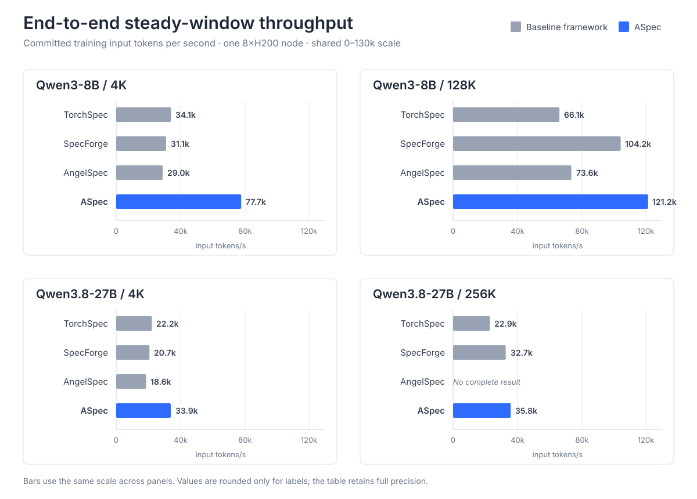

# Training benchmark results

This page reports the final **2026-10-30 H200 DSpark comparison** for Qwen3-8B
and Qwen3.8-27B. Throughput means committed training input tokens per second; it
is not speculative-decoding speed or an equal-quality training speedup.

The comparison uses an independent 512-anchor cap for every original document.
All headline rows use one padded document per Draft rank and microstep (BSHD
MBS1). TorchSpec, SpecForge and AngelSpec use the same native MBS1
semantics. Packed-token execution (THD) is reported separately as a layout and
capacity option; results are not selected opportunistically between layouts.

See [methodology](methodology.md) for the measurement contract and
[benchmark tools](README.md) for reproduction entry points.

## End-to-end training

One eight-GPU H200 node runs online Target feature generation, transport and
Draft training. The headline is a continuous **steady window** from completion
of warmup update eight through the final optimizer completion. It counts only
the actual tokens committed in that interval. Target supply, transport, Draft
training and the finite tail remain inside the window; cold compilation and
initial pipeline fill do not.

### Steady-window throughput

| Workload | TorchSpec MBS1 | SpecForge MBS1 | AngelSpec MBS1 | ASpec BSHD MBS1 | ASpec / TS, SF, AS |
| --- | ---: | ---: | ---: | ---: | --- |
| Qwen3-8B / 4K | 34,080.95 | 31,063.56 | 28,952.97 | **77,721.37** | **2.28x / 2.50x / 2.68x** |
| Qwen3-8B / 128K | 66,103.68 | 104,216.51 | 73,561.63 | **121,237.15** | **1.83x / 1.16x / 1.65x** |
| Qwen3.8-27B / 4K | 22,223.87 | 20,681.76 | 18,593.31 | **33,926.93** | **1.53x / 1.64x / 1.82x** |
| Qwen3.8-27B / 256K | 22,940.76 | 32,743.82 | No complete result | **35,805.46** | **1.56x / 1.09x / --** |

Ratios are calculated from unrounded steady rates. AngelSpec 27B/256K did not
complete under the tested native capacity, so it supplies no denominator.

### Complete-window reference

The complete window starts at native training-loop entry and includes cold
compilation, warmup and initial pipeline fill through the last optimizer
completion. It excludes process/model initialization, final save and shutdown.
These rates describe complete-corpus elapsed time and are not used in the
headline ratios above.

| Workload | TorchSpec MBS1 | SpecForge MBS1 | AngelSpec MBS1 | ASpec BSHD MBS1 |
| --- | ---: | ---: | ---: | ---: |
| Qwen3-8B / 4K | 32,291.61 | 29,628.43 | 27,575.80 | 68,348.38 |
| Qwen3-8B / 128K | 64,567.14 | 90,114.58 | 70,672.97 | 116,436.66 |
| Qwen3.8-27B / 4K | 21,538.26 | 20,048.01 | 18,162.37 | 32,481.90 |
| Qwen3.8-27B / 256K | 22,812.26 | 31,321.04 | No complete result | 35,377.05 |

### ASpec layout reference

ASpec's MBS has a different physical unit in the two layouts:

- **Padded documents (BSHD):** MBS1 means one original document per Draft rank
  and microstep.
- **Packed tokens (THD):** MBS1 means one packed token row per Draft rank and
  microstep. A row can contain several complete documents separated by explicit
  attention and position boundaries.

The same-window ASpec layout observations are below. BSHD MBS1 is the public
headline because it preserves the same physical microbatch semantics as the
external baselines across the full matrix. THD remains useful when several
documents must share a row, padding would otherwise dominate, or the resident
token set must fit a tighter memory budget; it is not an unconditional speed or
absolute-memory improvement.

| Workload | ASpec BSHD MBS1 steady (T+D) | ASpec THD steady (T+D) | Headline layout |
| --- | ---: | ---: | --- |
| Qwen3-8B / 4K | **77,721.37** (2+6) | 75,606.91 (2+6) | BSHD MBS1 |
| Qwen3-8B / 128K | **121,237.15** (6+2) | 127,645.69 (7+1) | BSHD MBS1 |
| Qwen3.8-27B / 4K | **33,926.93** (3+5) | 34,157.98 (3+5) | BSHD MBS1 |
| Qwen3.8-27B / 256K | **35,805.46** (6+2) | 35,810.69 (6+2) | BSHD MBS1 |

The 8B/128K role split differs, and natural THD uses dynamic original-document
counts per update; its 27B/256K run commits the 4,094-document
optimizer-aligned prefix. This table is therefore not a pure layout ablation.
The controlled resident comparison below holds the four documents fixed.

In a controlled Qwen3-8B/4K same-four-document resident comparison, BSHD MBS4
peaks at 57.08 GiB allocated while THD MBS1 peaks at 48.12 GiB, a 15.7%
reduction for THD. Their input rates are 15,809.82 and 15,738.93 tokens/s,
respectively, so this is a resident-memory result rather than a speedup claim.
Natural one-document MBS1 batches can instead give BSHD the lower absolute peak.
The headline fixes padded-document MBS1 across frameworks rather than selecting
a different physical microbatch size for each implementation.

### Work committed by ASpec

All headline rows use original documents as the logical batch unit.

| Workload | Target + Draft | Draft CP | Original documents/update | Committed documents / input tokens | Optimizer updates |
| --- | --- | ---: | ---: | --- | ---: |
| Qwen3-8B / 4K | 2+6 | 1 | 480 | 60,000 / 43,840,380 | 125 |
| Qwen3-8B / 128K | 6+2 | 1 | 4 | 4,096 / 132,381,588 | 1,024 |
| Qwen3.8-27B / 4K | 3+5 | 1 | 480 | 59,520 / 43,941,539 | 124 |
| Qwen3.8-27B / 256K | 6+2 | 2 | 4 | 4,096 / 132,455,651 | 1,024 |

The comparison fixes corpus identity, per-document anchor budget, original
documents per update and timing boundary. It does not claim equal independent
weight trajectories across different framework implementations.

## Draft-only training

Draft-only controls use one H200 GPU, CP1, common resident Target activations and
common initial Draft weights. They run 16 warmup plus 64 measured updates and
exclude Target execution, transport, feature loading and initialization. Every
framework uses padded-document MBS1; accumulation preserves the workload's
logical documents per update.

| Workload | TorchSpec MBS1 | SpecForge MBS1 | AngelSpec MBS1 | ASpec BSHD MBS1 | ASpec / TS, SF, AS |
| --- | ---: | ---: | ---: | ---: | --- |
| Qwen3-8B / 4K | 7,774.31 | 7,370.28 | 6,155.94 | **15,256.44** | **1.96x / 2.07x / 2.48x** |
| Qwen3-8B / 128K | 147,198.24 | 153,246.20 | 125,672.09 | **288,380.52** | **1.96x / 1.88x / 2.29x** |
| Qwen3.8-27B / 4K | 5,035.68 | 4,873.88 | 3,996.08 | **9,573.42** | **1.90x / 1.96x / 2.40x** |
| Qwen3.8-27B / 256K | 128,328.29 | 130,057.91 | Capacity failure | **229,232.34** | **1.79x / 1.76x / --** |

The ASpec rows use 64, 4, 64 and 4 original documents per optimizer update in
table order. These resident rates measure Draft execution capacity and must not
be substituted for online end-to-end throughput.

All measured ASpec updates have finite loss and gradient norm records and use
cuDNN attention on all five Draft layers. Common-state numerical and restore
checks are separate from these performance claims.

## Data and training semantics

- **4K:** existing Target-generated answers; no decoding or answer regeneration.
  The final 8B pass consumes 60,000 documents. The 27B tokenizer/admission yields
  the complete prefix disclosed above.
- **128K/256K:** 4,096 seed-42 LongCite conversations in frozen order, using each
  model's tokenizer. Conversations are not duplicated, truncated or expanded.
- **Supervision:** every original document has an independent cap of 512 anchors.
  Structurally unavailable anchors remain masked and are never repeated to fill
  the cap.
- **Precision/objective:** BF16 five-layer DSpark, block size 7, native framework
  optimizer and learning-rate semantics.
- **Tails:** finite tails are explicit and no work is duplicated. The 8B/27B
  4K runs drop the final 416/384 documents that cannot form a complete
  480-document update; the long-context runs consume all 4,096 documents.

Input-length labels identify the configured row capacity and workload, not a
requirement that a natural corpus contain a row at the exact ceiling.

## Runtime and framework identity

The comparison keeps each framework's normal software stack and native backend;
it is not a same-version kernel ablation.

| Framework | Source/runtime identity |
| --- | --- |
| ASpec | [Measured runtime snapshots](source-identities.json); PyTorch 2.13, SGLang 0.5.21, FA4 4.0.0b34, CUTLASS DSL 4.7.1, Quack 0.6.5, cuDNN with padded-document workload semantics (CP may flatten internally) |
| TorchSpec | `a4e5c1085bfc5990ddcae6cf5832bb26380b38d3`; PyTorch 2.11, SGLang 0.5.19.dev |
| SpecForge | `03f3682ea852b73488d62dab4cd539033cc60e3e`; PyTorch 2.13, SGLang 0.5.18 |
| AngelSpec | Based on [`d3412bed231025ea85d35dbf5e0af44f1ac62a5b`](https://github.com/Tencent/AngelSpec/commit/d3412bed231025ea85d35dbf5e0af44f1ac62a5b), with compatibility patches for the tested configuration and normal NVLink feature transport; [measured runtime snapshots](source-identities.json); PyTorch 2.9.1, SGLang 0.5.18 |

The ASpec and modified AngelSpec measurements used source exports without Git metadata.
The [source identities](source-identities.json) bind every completed row to the runtime-module
SHA-256 values recorded by its adapter, with separate online and resident measurements.
Git revisions for those exports remain `null`; the AngelSpec revision above identifies the upstream
base. The fingerprints cover the captured modules, while dependencies and workload settings are
reported separately.

Normal NVLink and capacity-correct source/ready/destination/host buffers are
enabled where supported. No CPU, tile, kernel or learning-rate sweep is used to
manufacture an individual result. These are single-run observations, without a
repeated-run confidence or statistical-significance claim.

## Related measurements

- [DeepSpec comparison](deepspec.md): resident Draft training and the native
  cache-first workflow, reported under their separate timing boundaries.
- [EAGLE3](eagle3-h200.md): train-core latency, memory and numerical scope.
- [Packed attention with CP](cudnn-thd-cp.md): component-level attention results.
- [Training and acceptance](dspark-alignment.md): TorchSpec/ASpec BSHD/THD
  training alignment and verifier metrics, separate from input throughput.
- [CP quality alignment](dspark-cp-alignment.md): CP2 versus same-layout CP1
  for ASpec BSHD and THD.

## Reproduce a comparison

Start with the [benchmark tools and templates](README.md). Match the dataset,
tokenizer, initial Draft weights, per-document anchor policy, role split, logical
work per update and timing boundary. Record physical MBS in its layout-specific
unit, packed rows, original documents, input tokens, optimizer updates and finite
tails separately. Keep generated data, logs, checkpoints and profiler traces
outside the public source tree.
